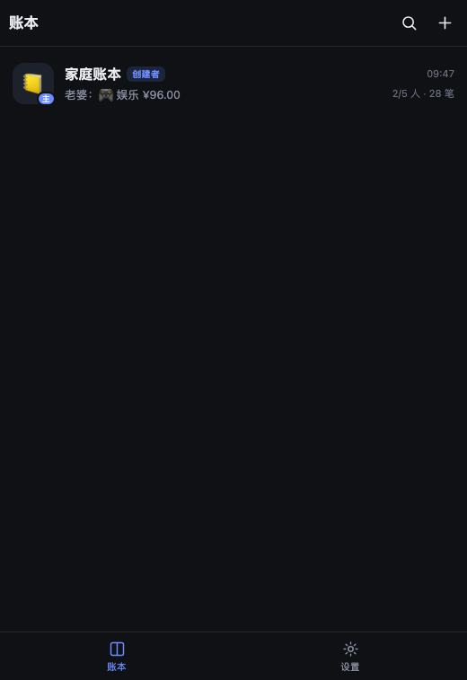
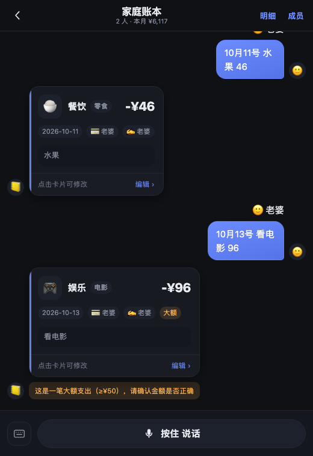
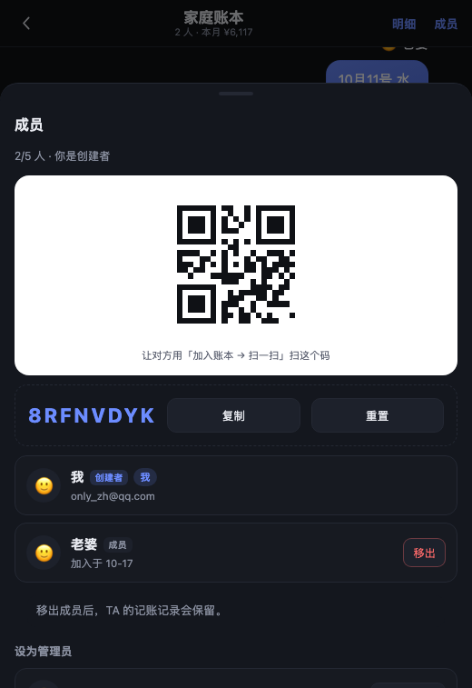
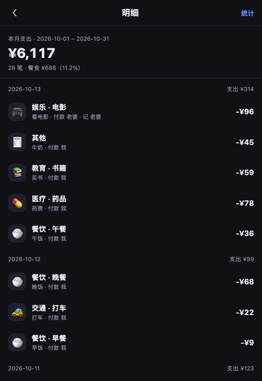
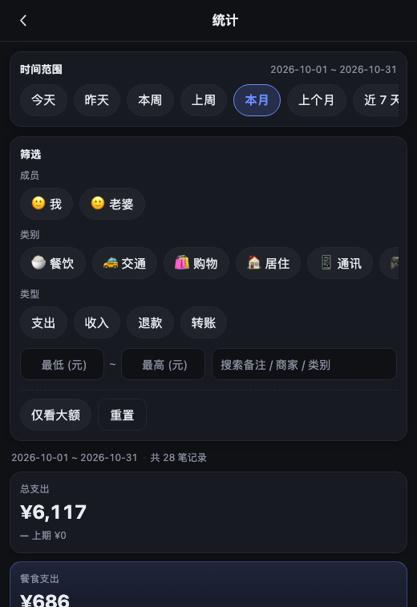
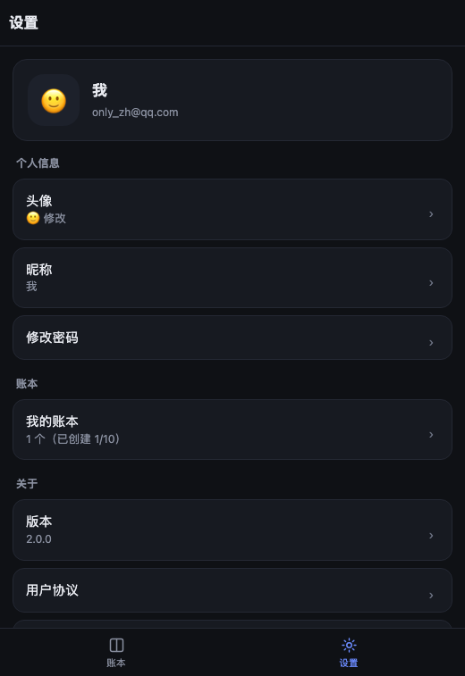

# 记账本 · 聊天式多人记账

像聊天一样记账：**按住说话或打字 → 自动识别金额、类别、日期、谁花的 → 生成可点击修改的记账卡片**。
一个账本就像一个群：成员各记各的、互相可见；只有本人或管理员能改卡片；每个账号最多建 10 个账本、每个账本最多 5 人。

| 账本列表（首页） | 群聊记账 | 成员与邀请码 |
|---|---|---|
|  |  |  |

| 明细 | 统计 | 设置 |
|---|---|---|
|  |  |  |

---

## 1. 快速开始

```bash
# 1) 启动服务（零依赖，不需要 npm install）
node server/index.js

# 2) 打开浏览器，注册或登录
open http://127.0.0.1:8787
```

**演示账号**（`tools/seed-demo.mjs` 生成，请登录后改密码）：

| 角色 | 邮箱 | 密码 |
|---|---|---|
| 创建者 | `demo@example.com` | `Demo123456` |
| 普通成员 | `wife@demo.local` | `Demo123456` |

配置在 `.env`（已 gitignore）。注册验证码走 **QQ 邮箱 SMTP 真发信**（`smtp.qq.com:465 / SSL`，密码填邮箱授权码）。
没配 SMTP 时自动进入**开发模式**：验证码直接显示在注册页并打印到服务端日志，方便本地联调。

## 2. 商业化规则（全部由服务端强校验）

| 能力 | 创建者 owner | 管理员 admin | 普通成员 member |
|---|---|---|---|
| 查看明细 / 表格 / 统计 | ✅ | ✅ | ✅ |
| 修改**自己发送**的卡片 | ✅ | ✅ | ✅ |
| 修改**任何人**的卡片 | ✅ | ✅ | ❌ 403 |
| `@某人` 帮别人记账 | ✅ | ✅ | ❌ @ 被忽略并提示 |
| 分配 / 撤销管理员 | ✅ | ❌ 403 | ❌ 403 |
| 移出成员 | ✅ 任何人（创建者除外） | ✅ 仅普通成员 | ❌ 403 |

> **被 @ 的人也有一条修改权**：管理员用 `@张三 买菜 30` 记账后，这笔记在张三名下，
> 张三虽然不是作者也能修改（`author` / `payer` / 管理员三者任一即可）。

- **配额**：每个账号最多创建 **10** 个账本（加入别人的不占额度）；每个账本最多 **5** 人（含创建者）。
- **邀请码**：账本内 8 位邀请码（剔除 0/O/1/I），管理员可查看/复制/重置，对方输入即加入，满员自动失效。
- **数据分发**：所有数据接口都按账本隔离，非成员读写一律 403/404 —— 这是多租户的边界。
- 记录分两个"人"：`author`（谁发的，决定谁能改）与 `payer`（这笔钱谁花的，由 `@` 决定）。

## 2.1 界面结构

```
账本列表（首页）
 ├─ 右上角 🔍 搜索：同时搜账本名与记账记录（备注/类别/商户/金额），只搜我参与的账本
 ├─ 右上角 ＋    ：创建账本（名称 + 预设图标，不允许自定义）/ 加入账本（邀请码 或 扫一扫）
 ├─ 点某个账本   → 群聊页
 │    ├─ 左上角 ← 返回
 │    ├─ 右上角 明细 → 明细页（按天分组，点条目可改）→ 统计
 │    └─ 右上角 成员 → 成员与邀请码（二维码可直接扫）
 └─ 底部两个 tab：账本 / 设置
      └─ 设置页：头像（预设）/ 昵称 / 修改密码 / 我的账本 / 版本 / 退出登录
           （服务器地址、解析引擎、邮件与语音服务状态都属于内部信息，收在「长按版本 800ms」的调试面板里）
```

- 首页是**会话列表**：每行显示账本图标（创建者带「主」、管理员带「管」角标）、名字、最后一条消息、时间、人数与笔数。
- 邀请码面板会显示**二维码**（内部实现了一个零依赖的 QR 编码器，版本 1~4 / 纠错 L），对方用「加入账本 → 扫一扫」直接扫；
  扫码用浏览器原生 `BarcodeDetector` 解码，不支持时自动退化为手动输入。
- 成员被移出后，**TA 的记账记录仍然保留**，卡片上仍能显示作者名（接口额外返回 `authors` 列表）。
- **@ 帮人记账**：管理员在输入框打 `@` 会弹出成员列表（支持模糊匹配、↑↓ 选择、回车确认）；
  被 @ 的人会在账本列表看到 `＠n` 徽标、卡片上有 `＠我` 标记，进入账本后自动清除。
- **消息自动刷新**：停留在群聊页时每 5 秒增量同步一次（切到后台暂停），别人发的新消息不用退出重进。

## 2.2 界面上不出现"内部信息"

产品原则：**只显示用户需要用来做决定的信息**。技术细节一律收进「长按版本 800ms」的调试面板或服务端日志。

已按这条原则清理过的内容：

| 位置 | 之前 | 现在 |
|---|---|---|
| 设置页 | 「解析引擎」一行 | 移入调试面板 |
| 聊天输入区 | DeepSeek / 演示解析 徽标 | 移除 |
| 成员面板 | 所有成员的邮箱 | 自己显示邮箱，他人显示「加入于 MM-DD」 |
| 记账卡片 | 「🎙 语音」标签 | 移除（输入方式不值得长期展示） |
| 解析警告 | 「模型调用失败（fetch failed）」「未配置大模型…」 | 只进服务端日志；用户看到「智能解析暂时不可用，这笔是按规则识别的，请确认卡片信息」 |
| 发送失败 | 「请求失败（HTTP 500）」 | 「服务暂时不可用」「网络不可用」「登录已过期」等可理解的原因 |
| 语音失败 | 提示去 `.env` 配置 `ASR_*` | 「当前没有开启语音识别，可以先改用文字输入」 |
| 设置页版本 | `2.0.0 · 商业版` | `2.0.0` |
| 首页会话预览 | `老婆：🎮 娱乐 ¥96.00（2026-10-13）` | `老婆：🎮 娱乐 ¥96.00`（右侧已有时间） |
| 离线条 | 「离线 · 只读」 | 「当前离线 · 只能查看已同步的记录」 |
| 登录页 | 「数据保存在所连接的服务器上」 | 「你的记账数据仅同一账本的成员可见」 |
| 构建配置缺失 | 「这个安装包没有配置服务器地址」 | 「安装包配置有误，请联系提供者」 |

保留的用户信息：配额（`1/10`、`2/5 人`）、大额阈值（`≥¥50`）、权限提示（「仅可查看（别人发送的）」）、
「已移出」标注、邀请码与二维码——这些都会影响用户的行为判断。

### 协议与隐私

登录/注册页底部常驻「《用户协议》/《隐私政策》」链接（设置页「关于」里也有入口），
两份文档与当前实现一致（密码哈希、按账本隔离、音频不留存、文本会发给所配置的模型服务），
文件为 `public/terms.html`、`public/privacy.html`。**上线前请补充运营主体、联系方式、生效日期并经法务确认。**

## 3. 账号与安全

- 注册：邮箱 → 6 位验证码（**10 分钟有效、单码最多试 5 次、60 秒可重发、每小时上限 6 次**）→ 设昵称与密码。
- 密码：**scrypt 加盐哈希**（`node:crypto`，不存明文），要求 ≥8 位且含字母和数字。
- 会话：`Authorization: Bearer <64 位随机 token>`，默认 30 天；改密码会让其它设备下线。
- 验证码**一次性**且**与邮箱绑定**；注册时先校验昵称/密码/邮箱是否已注册，最后才消费验证码（密码不合规不会浪费验证码）。

## 4. 断网行为（按需求：不允许断网使用）

| 场景 | 表现 |
|---|---|
| 打开 App 且能连服务器 | 增量拉取最新数据（`/api/sync?since=`），服务器是唯一权威源 |
| 断网 / 服务器不可达 | 顶部出现**「离线 · 只读」**提示；可查看本地缓存的记录与卡片 |
| 断网时发送 | **不入账**；消息气泡整条**标红**并标注「未发送」，带「重试 / 丢弃」 |
| 恢复网络 | 点「重试」会先探活再发送；同一 `clientMsgId` 幂等，不会重复记账 |

没有「本地模式」：不登录、不连服务器就无法记账（这是刻意的）。

## 5. 聊天输入与语音

- 底部**长按说话**（主要输入方式），右侧键盘图标切文字输入；松开发送、上滑取消。
- 支持的说法：`昨天午饭35`、`打车28块5`、`三十五块五`、`3月5号买菜50`、`发工资8000`、`这个月餐饮花了多少`、`撤销`、`把刚才那笔改成35`。
- **@ 记账直接在聊天框输入**（没有额外按钮）：管理员输入 `@老婆 买水果 40` 表示「水果钱是老婆花的，我帮她记」；普通成员这样输入会被忽略并提示。
- 语音识别走服务端（可选）：`.env` 里配 `ASR_PROVIDER=openai-compatible` + `ASR_BASE_URL/ASR_API_KEY`。**不保留录音**，转写后即丢弃。

## 6. 统计页

自绘 SVG 图表（无 CDN、可离线）：日期范围预设 + **自定义起止**、成员/类别/类型/金额区间/关键词筛选、
指标卡（总支出含环比、笔数、日均、单笔均值、最大一笔、**餐食金额与占比**、大额消费笔数合计、收入与结余）、
每日折线、分类环形、成员柱状（可切「我付的 / 我该承担的」）、**日历天维度**、星期分布、大额消费列表、分类明细。
点图表里的分类/成员/日期会变成筛选条件；点记录行打开详情。

## 7. 部署到云服务器

完整步骤见 **[docs/DEPLOY.md](docs/DEPLOY.md)**（以火山引擎为例：安全组、备案、Node 版本、systemd、HTTPS、备份、排错）。

仓库里已经备好可直接用的文件：

| 文件 | 用途 |
|---|---|
| `deploy/keep-accounts.service` | systemd 常驻（开机自启、崩溃重启、只监听本机、权限收敛） |
| `deploy/nginx.conf` | Nginx 反代 + HTTPS（含超时与 30MB 上传上限） |
| `deploy/Caddyfile` | Caddy 反代（自动申请证书，最省事） |
| `deploy/preflight.sh` | 部署前自检：Node 版本、`node:sqlite`、`.env` 权限、数据目录、端口占用 |
| `deploy/backup.sh` | WAL 安全的在线备份（`VACUUM INTO` + gzip + 保留 14 天） |
| `deploy/keep-accounts-backup.{service,timer}` | 每天 03:30 自动备份 |

最短路径：

```bash
# 服务器
sudo -u keep git clone <仓库> /opt/keep-accounts
sudo -u keep cp .env.example .env && sudo -u keep nano .env   # 填 SMTP / 模型 Key
bash deploy/preflight.sh                                     # 先自检
sudo cp deploy/keep-accounts.service /etc/systemd/system/ && sudo systemctl enable --now keep-accounts
sudo cp deploy/Caddyfile /etc/caddy/Caddyfile && sudo systemctl reload caddy

# 开发机（把域名打进 APK）
KA_API_BASE=https://你的域名 bash build.sh
```

## 7.1 应用内更新

APK **不读取远端页面**：界面资源打在包里，通过 `https://appassets.local`（由 WebView 拦截，不会真的联网）
提供给页面，这样既能离线打开、又满足"安全上下文"要求（摄像头/麦克风才可用）。

更新流程：

```bash
# 1) 开发机：改版本号后重新打包
KA_API_BASE=https://你的域名 KA_VERSION_CODE=3 KA_VERSION_NAME=1.0.2 bash build.sh

# 2) 把新包传到服务器
scp dist/keep-accounts.apk keep@SERVER:/opt/keep-accounts/downloads/keep-accounts.apk

# 3) 服务器：声明新版本
sudo -u keep nano /opt/keep-accounts/.env
#   APP_VERSION_CODE=3
#   APP_VERSION_NAME=1.0.2
#   APP_UPDATE_NOTES=修复语音卡死
#                    新增 @ 提醒
sudo systemctl restart keep-accounts
```

手机上打开 App 会：

- 启动时检查 `/api/app-version`，有新版本自动弹更新面板（含更新说明）；
- 设置页「版本」右侧显示「发现新版本 x.y.z」并带红点，**底部「设置」tab 也有红点**；
- 点「立即更新」→ 系统下载 APK → 弹出安装界面（需允许"安装未知来源应用"）。

`APP_VERSION_CODE=0`（默认）表示不提供更新，App 不会提示。

## 8. 打包成 APK

不需要 Gradle / AndroidX：手写 WebView 壳 + `aapt2/d8/apksigner` 构建。

```bash
bash build.sh                 # 产出 dist/keep-accounts.apk
adb install -r dist/keep-accounts.apk
```

- **接口地址是构建期常量，不是用户设置项**：APK 由 `KA_API_BASE` 在打包时写进包内 `config.js`，
  用户在界面上看不到也改不了（避免把 token 发到任意主机）。浏览器同源部署时留空即用当前域名。
  ```bash
  KA_API_BASE=https://your.domain bash build.sh       # 正式包
  KA_API_BASE=http://192.168.1.9:8787 bash build.sh   # 局域网联调
  ```
  内部联调还有两个入口：URL 加 `?server=http://host:8787`，或在设置页**长按「版本」800ms** 打开调试面板
  （面板里有：接口地址及来源、解析引擎、邮件/语音服务、版本与数据结构版本、时区与配额、账号 ID，以及地址覆盖框）。
- 签名：`android/keystore/keep-accounts.jks`（alias `keep`，口令 `keepaccounts`）。**首次构建自动生成，之后不会覆盖**。
- 原生桥 `NativeHttp` 负责绕开 `file://` 的 CORS 限制；麦克风权限自动申请。

> **改 Android 源码的硬约束**：build-tools 34 自带的 R8/D8 8.2.2 遇到**匿名内部类**和**非静态内部类**会崩
> （`NullPointerException: Cannot invoke "String.length()"...`）。所以 Java 代码一律用 **lambda** 或
> **static 嵌套类 + 显式持有 Activity 引用**，否则 `bash build.sh` 会在 d8 阶段失败。

## 9. 目录结构

```
server/
  index.js      路由（鉴权 + 账本作用域）、静态资源、/api/asr
  db.js         schema v2（accounts/sessions/email_codes/books/book_members/records/messages/ai_audit）
  auth.js       验证码、scrypt 密码、会话、限流
  store.js      账本/成员/角色/配额/记录/消息（含 assertCanEdit 权限兜底）
  mailer.js     零依赖 SMTP 客户端（node:net/node:tls，RFC2047 中文主题、AUTH PLAIN/LOGIN、STARTTLS）
  adapters/     llm.js（DeepSeek/mock）、asr.js（OpenAI 兼容）
shared/         前后端共用：parse-core / normalize / date / categories / chat（@权限）/ pipeline / stats
public/         前端：index.html + css/ + js/{app,store,db,native,llm,recorder,charts,stats-page}.js + selftest.html
tests/          parse.test.mjs(76) api.test.mjs(94) smtp.test.mjs(73)
tools/          seed-demo.mjs（演示账号 + 账本 + 示例账目）
android/        WebView 壳
docs/           设计文档与截图
```

## 10. 测试

```bash
node tests/parse.test.mjs      # 解析回归 76 项
node tests/qr.test.mjs         # 邀请二维码编码器 31 项（结构校验）
node tests/api.test.mjs        # 账号/配额/邀请/权限/隔离/搜索/移出成员 112 项
node tests/smtp.test.mjs       # SMTP 客户端 73 项（自带 mock 服务器，含 SSL 与 STARTTLS）
```

浏览器端到端自检（需要服务端处于**开发模式**，验证码会回显）：

- `http://127.0.0.1:8787/selftest.html` —— 49 项：三账号注册、权限随角色变化、@ 降级、断网标红、统计渲染、登出
- `http://127.0.0.1:8787/qr-selftest.html` —— 7 项：把我的二维码编码器画到 canvas，再用浏览器原生 `BarcodeDetector` 解码回来比对

> 这两个页面都依赖异步结果，`--virtual-time-budget` 会卡住（原生后台任务不受虚拟时钟驱动）。
> 仓库里附了一个零依赖的 CDP 小工具 `tools/cdp.mjs`（`withPage` / `withPageSteps` / `waitFor`），按真实时间等待并支持截图。

```bash
MAIL_PROVIDER=none DEV_SHOW_CODE=true node server/index.js   # 用临时库另起一个实例
open http://127.0.0.1:8787/selftest.html
```

无头运行：

```bash
"/Applications/Google Chrome.app/Contents/MacOS/Google Chrome" --headless=new --no-sandbox \
  --user-data-dir=/tmp/ka --virtual-time-budget=60000 --dump-dom \
  http://127.0.0.1:8787/selftest.html | grep -o 'data-e2e-failed="[0-9]*"'
```

## 11. 配置项（.env）

| 键 | 默认 | 说明 |
|---|---|---|
| `KA_API_BASE`（构建期，非 .env） | 空 | 打进 APK 的接口地址；不设置则 APK 无法登录 |
| `PORT` / `HOST` | `8787` / `0.0.0.0` | 监听地址（`0.0.0.0` 才能被手机访问） |
| `DB_PATH` | `./data/ledger.db` | SQLite 路径 |
| `TZ` | `Asia/Shanghai` | 「今天」的锚点时区 |
| `SMTP_HOST` / `SMTP_PORT` / `SMTP_SECURE` | 空 / `465` / `ssl` | QQ 邮箱用 `smtp.qq.com:465` + `ssl` |
| `SMTP_USER` / `SMTP_PASS` / `SMTP_FROM` | 空 | QQ 邮箱的 `SMTP_PASS` 填**授权码**，不是登录密码 |
| `MAIL_PROVIDER` | `auto` | `auto`/`smtp`/`none`；`none` = 开发模式（验证码回显） |
| `DEV_SHOW_CODE` | `auto` | `auto` = 没配 SMTP 才回显；**上线务必 `false`** |
| `MAX_BOOKS_PER_ACCOUNT` | `10` | 每个账号最多创建的账本数 |
| `MAX_MEMBERS_PER_BOOK` | `5` | 每个账本最多成员数 |
| `SESSION_DAYS` | `30` | 会话有效期 |
| `CODE_TTL_MINUTES` / `CODE_RESEND_SECONDS` | `10` / `60` | 验证码有效期与重发间隔 |
| `LLM_PROVIDER` / `DEEPSEEK_API_KEY` | `auto` / 空 | 空则用「演示解析」（本地规则，结构与模型一致） |
| `ASR_PROVIDER` / `ASR_BASE_URL` / `ASR_API_KEY` | `none` / 空 | 语音识别（OpenAI 兼容） |
| `LARGE_THRESHOLD_CENTS` | `5000` | 大额阈值（分）= 50 元 |

## 12. 已知边界与后续

- **未做**：导出（按需求暂不做）、找回密码（`email_codes` 已有 `reset` 用途，表结构就绪）、邮箱变更、账号注销。
- **建议上线前补强**：`/api/auth/code` 加 IP 维度限流（目前只有邮箱维度，可被用来探测邮箱是否存在）、
  登录失败次数限制、HTTPS（反向代理）、`DEV_SHOW_CODE=false`、定期备份 `data/ledger.db`
  （**WAL 文件要一起备份**，或先 `PRAGMA wal_checkpoint(TRUNCATE)`）。
- 账本容量默认 5 人 / 账号 10 本，都在 `.env` 里可调。
